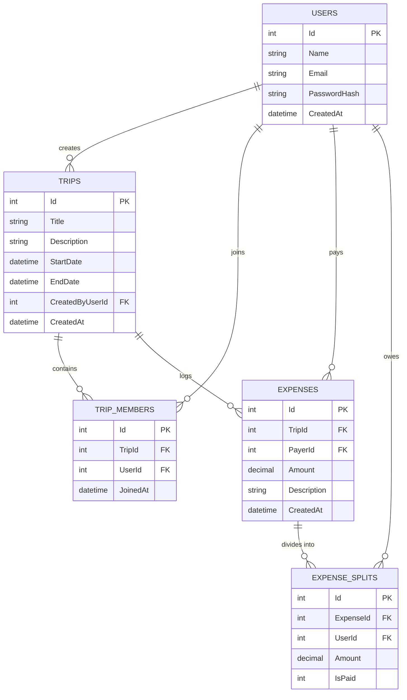

# TripSplit — Group Travel Expense Splitter

An enterprise-ready, full-stack web application designed for group travelers to seamlessly manage shared itineraries, track group expenditures, automatically compute equal expense splits, and track debt settlements in real time.

---

## Architecture & Tech Stack

| Layer | Technology | Description |
| :--- | :--- | :--- |
| **Backend** | **C# ASP.NET Core 10 Web API** | RESTful services, dependency injection, and endpoint routing |
| **ORM & Database** | **Entity Framework Core 10 & SQLite** | Cross-platform relational database (`ExpenseSplitter.db`) |
| **Security** | **JWT & BCrypt.Net** | Stateless Bearer token authentication and cryptographic password hashing |
| **Frontend** | **React 19 & Vite** | Component-driven responsive user interface |
| **Styling** | **Modern CSS3 (Design System)** | High-contrast enterprise light palette with semantic indicators |

---

## Core Features

- **Secure Authentication**: User registration and login protected with salted BCrypt password hashing and JWT authentication.
- **Trip & Group Management**: Create travel groups and invite participants by email.
- **Automated Equal Expense Splitting**: Log an expense paid by any member; the system automatically divides the total equally across all trip members and creates individual split ledgers.
- **Real-Time Financial Dashboard**:
  - **Total Contributed**: Sum of expenses paid by the user.
  - **You Owe**: Total pending debt owed to other members.
  - **You Are Owed**: Total pending amount others owe to the user.
- **Debt Settlement Workflow**: Instant settlement mechanism updating split records (`IsPaid = true`) with audit trail.
- **Enterprise UI**: Clean, professional interface with universal placeholders, responsive tables, and zero visual clutter.

---

## Database Schema

The database consists of 5 relational tables configured via Entity Framework Core:



---

## API Endpoints

### Authentication & Users
| Method | Endpoint | Description |
| :--- | :--- | :--- |
| `POST` | `/api/auth/register` | Register a new user account |
| `POST` | `/api/auth/login` | Authenticate and obtain JWT token |
| `GET` | `/api/users` | Retrieve list of registered users |

### Trips & Members
| Method | Endpoint | Description |
| :--- | :--- | :--- |
| `GET` | `/api/trips` | Get all trips for the authenticated user |
| `POST` | `/api/trips` | Create a new trip |
| `GET` | `/api/trips/{id}` | Get trip details with members and expenses |
| `POST` | `/api/trips/{id}/members` | Add a member to a trip by email |

### Expenses & Splitting
| Method | Endpoint | Description |
| :--- | :--- | :--- |
| `POST` | `/api/expenses` | Record an expense (automatically splits among trip members) |
| `GET` | `/api/expenses/trip/{tripId}` | Get all expenses recorded for a trip |
| `PUT` | `/api/expenses/splits/{splitId}/settle` | Settle an individual expense split (`IsPaid = true`) |

### Dashboard & Analytics
| Method | Endpoint | Description |
| :--- | :--- | :--- |
| `GET` | `/api/dashboard/{userId}` | Calculate user balances (You Owe, Owed to You, Total Spent) |

---

## Repository Structure

```
spillet_Expence/
├── Backend/
│   ├── ExpenseSplitter.db          # Active SQLite database file
│   ├── ExpenseSplitterApi.csproj   # .NET project configuration
│   ├── ExpenseSplitterApi.http     # HTTP test endpoints
│   ├── Program.cs                  # Application host and dependency configuration
│   ├── Controllers/                # REST API controllers
│   ├── Data/                       # Entity Framework DbContext
│   ├── DTOs/                       # API request and response models
│   ├── Models/                     # Entity models
│   ├── Migrations/                 # EF Core database migrations
│   ├── appsettings.json            # Configuration & SQLite connection string
│   └── appsettings.Development.json
├── Frontend/
│   ├── public/
│   │   └── favicon.svg             # Application brand mark
│   ├── src/
│   │   ├── App.jsx                 # Core application component & views
│   │   ├── App.css                 # Application styling system
│   │   ├── index.css               # Global baseline typography & resets
│   │   └── main.jsx                # React DOM entry point
│   ├── index.html                  # HTML template
│   ├── package.json                # Frontend dependencies and scripts
│   ├── vite.config.js              # Vite configuration
│   └── README.md                   # Frontend-specific documentation
└── README.md                       # Comprehensive project guide
```

---

## Getting Started

### Prerequisites
- [.NET 10.0 SDK](https://dotnet.microsoft.com/download) (or .NET 8.0+)
- [Node.js](https://nodejs.org/) (v18 or higher)
- [npm](https://www.npmjs.com/)

---

### 1. Backend Setup

1. Open your terminal and navigate to the `Backend` directory:
   ```bash
   cd Backend
   ```

2. Run the Web API server:
   ```bash
   dotnet run
   ```
   The backend API will start on: **`http://localhost:5033`**
   - OpenAPI / Swagger documentation is available at: `http://localhost:5033/openapi/v1.json`

---

### 2. Frontend Setup

1. Open a new terminal and navigate to the `Frontend` directory:
   ```bash
   cd Frontend
   ```

2. Install dependencies (if not already installed):
   ```bash
   npm install
   ```

3. Start the development server:
   ```bash
   npm run dev
   ```
   The frontend will be available at: **`http://localhost:5173`**

---

### 3. Inspecting the Database

To view database records directly:
- **VS Code Extension**: Install the **SQLite Viewer** extension and click on `Backend/ExpenseSplitter.db`.
- **Command Line**:
  ```bash
  sqlite3 Backend/ExpenseSplitter.db -box "SELECT * FROM Users;"
  sqlite3 Backend/ExpenseSplitter.db -box "SELECT * FROM Trips;"
  sqlite3 Backend/ExpenseSplitter.db -box "SELECT * FROM Expenses;"
  ```
